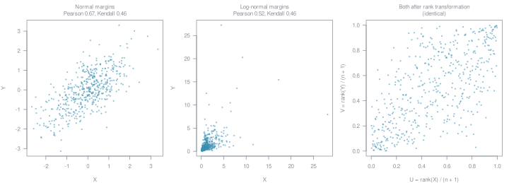
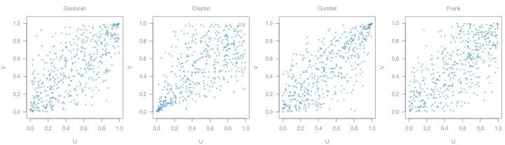

## Why copulas?

Many questions in the environmental sciences involve several variables at once: rainfall and river discharge, temperature at neighbouring stations, deforestation this year and last year. How these variables behave *together* matters as much as how each behaves on its own. A flood risk assessment, for example, depends on how likely high discharge and high water levels are to occur at the same time.

Copulas are a tool for exactly this. They separate a multivariate distribution into two parts that can be studied and modelled independently:

- the **margins**, i.e. the distribution of each variable on its own, and
- the **copula**, i.e. the dependence structure that links them.

This separation makes it possible to combine any kind of marginal distribution (skewed, heavy-tailed, bounded) with a dependence structure that goes far beyond a single correlation coefficient.

## Margins and joint distributions

Think of the body weight and body height of students. Each of the two has its own distribution, its *margin*. Taken together, the pairs (weight, height) follow a *joint* distribution, which in a scatterplot shows up as a cloud of points with some positive dependence.

A joint distribution is fully described by its joint cumulative distribution function (cdf)

$$
H(x, y) = P(X \le x,\ Y \le y),
$$

the probability of observing a pair in the lower-left quadrant of the point $(x, y)$. The margins $F(x) = P(X \le x)$ and $G(y) = P(Y \le y)$ are the views of this distribution from each axis.

A simple but central fact makes copulas work: if a continuous random variable $X$ has the cdf $F$, then $F(X)$ is uniformly distributed on $[0, 1]$. Transforming every variable through its own cdf therefore puts all variables on the same scale, no matter how differently they were distributed before.

## Sklar's theorem

Sklar's theorem (1959) states that every joint distribution can be written as

$$
H(x, y) = C\big(F(x),\, G(y)\big),
$$

where $C$ is a **copula**: a joint distribution function on the unit square $[0, 1]^2$ whose margins are uniform. If the margins $F$ and $G$ are continuous, the copula $C$ is unique.

Read the other way round, the theorem is a construction kit: pick any margins, pick any copula, and their combination is a valid joint distribution. The same holds in more than two dimensions.

## Measuring dependence

The most familiar measure of dependence is Pearson's correlation coefficient. It describes *linear* dependence and is affected by the shape of the margins. Rank-based measures avoid this by only comparing the order of observations:

- **Spearman's rho** is Pearson's correlation computed on the ranks of the data.
- **Kendall's tau** compares all pairs of observations and counts how many are *concordant* (both variables increase together) versus *discordant*.

The figure below shows one and the same dependence structure combined with two different sets of margins. Pearson's correlation changes with the margins, while Kendall's tau stays the same. After a rank transformation $u = \operatorname{rank}(x) / (n + 1)$, both samples become identical: what remains is the copula.

{fig-alt="Three scatterplots. Left: a sample with normal margins, Pearson correlation 0.67 and Kendall's tau 0.46. Middle: the same sample with log-normal margins, Pearson correlation 0.52 and Kendall's tau 0.46. Right: both samples after rank transformation to the unit square, which look identical."}

For many copula families, Kendall's tau and Spearman's rho are in a one-to-one relation with the copula parameter. This offers a simple way to estimate a copula from data.

## Copula families

There are many parametric copula families, and they differ most in their **tails**: how strongly the variables depend on each other when both take extreme values. The four samples below all have the same Kendall's tau of 0.5, yet their dependence structures are clearly different:

{fig-alt="Four scatterplots on the unit square. Gaussian: symmetric elliptical cloud. Clayton: points concentrated in the lower-left corner. Gumbel: points concentrated in the upper-right corner. Frank: symmetric with weak dependence in both corners."}

- The **Gaussian** copula is symmetric and has no tail dependence: joint extremes are comparatively rare.
- The **Clayton** copula shows strong dependence in the lower tail: small values tend to occur together.
- The **Gumbel** copula shows strong dependence in the upper tail: large values tend to occur together, a typical pattern for floods or heat waves.
- The **Frank** copula is symmetric and, like the Gaussian, has no tail dependence; joint extremes are even rarer.

Beyond these classical families, asymmetric copulas allow for dependence structures that are not mirror-symmetric. For more than two variables, **vine copulas** build a high-dimensional copula from a cascade of bivariate building blocks, which keeps the model flexible and tractable.

Tails matter. Heavy-tailed distributions assign far more probability to extreme values than the normal distribution: a value four standard deviations above the mean is about 100 times more likely to be exceeded under a Gumbel distribution than under a normal distribution with the same mean and variance, and five standard deviations above the mean, more than 3,000 times. A dependence model that ignores the tails can severely underestimate the risk of joint extremes.

## Modelling with copulas

A typical copula analysis follows a few steps:

1. **Fit the margins.** Each variable is modelled on its own, for example by maximum likelihood. This is a one-dimensional task and well established in statistics.
2. **Transform to the unit square.** Either through the fitted margins or, without any assumption, through the rank transformation.
3. **Explore the dependence.** Scatterplots and density plots of the rank-transformed data reveal tail behaviour and asymmetries that a correlation coefficient hides.
4. **Fit a copula.** Choose a family and estimate its parameters, by inverting Kendall's tau or by maximum likelihood.
5. **Check the fit.** Goodness-of-fit tests compare the fitted model with the data, often by parametric bootstrap.
6. **Use the model.** Combine copula and margins to compute joint probabilities, conditional distributions, return periods or risk maps, and to simulate new data.

Real data does not always meet the assumptions of continuous margins. Rainfall, radiation measurements or deforestation often contain a large share of zeros. For such *zero-inflated* data, the unit square can be split into a part for the zeros and a part for the positive values, each modelled separately. In a study on deforestation in the Brazilian Amazon, this approach was used to derive maps of the risk that deforestation exceeds a given threshold (Gräler et al. 2010, see [publications](publications.qmd)).

## Getting started in R

The [copula](https://cran.r-project.org/package=copula) package provides a wide range of copula families together with estimation, simulation and goodness-of-fit tools. [VineCopula](https://cran.r-project.org/package=VineCopula) adds bivariate families and vine copulas.

```r
library(copula)

# simulate from a Gumbel copula with Kendall's tau of 0.5
cop <- gumbelCopula(iTau(gumbelCopula(), 0.5))
u <- rCopula(500, cop)

# rank-transform data and estimate the copula parameter
fit <- fitCopula(gumbelCopula(), pobs(u), method = "itau")
summary(fit)
```

The [copulatheque](https://copulatheque.shinyapps.io/copulas/) lets you explore different copula families interactively in the browser.

## Spatial copulas

<!-- Content on spatial copulas to follow. -->
